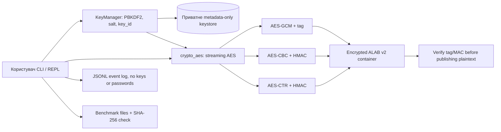

# Архітектура AES-Lab



## Формат ALAB v2

```
MAGIC (4 bytes: ALAB) | HEADER_SIZE (2-byte big-endian) |
HEADER (strict JSON, <=2048 bytes) | CIPHERTEXT (streamed chunks) | AUTH TAG
```

Заголовок включає `v`, `key_id`, `mode`, `iv`, `key_bits`, `block_bits=128`, `padding`. У GCM **нешифрований заголовок** подано як AAD у механізм автентифікації. Для CBC і CTR HMAC обчислено над framed `HEADER + len(external_AAD) + external_AAD + ciphertext` (IV є частиною JSON-заголовка). Жоден режим не приймає самовільно змінені параметри шифрування.

Розмір MAC: CBC/CTR — 32 байти; GCM — 16 байтів. При розшифруванні режим і key_id визначаються з контейнера; обраний у поточній REPL режим впливає на **нове шифрування**, не на спосіб дешифрування старого файлу.

**Властивість:** захищено від зміни заголовка, тіла та тегу; **не захищено від повного повторного відтворення (replay)** старого автентичного контейнера. 
