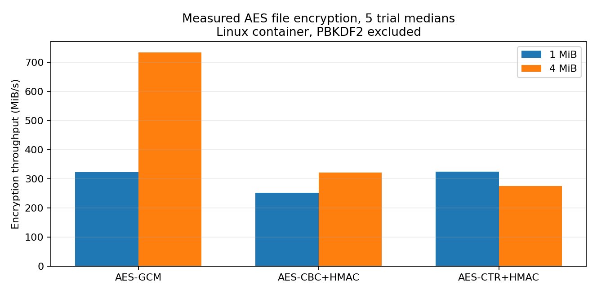

# Методика дослідження швидкодії й ресурсів

1. Дані створюються з `secrets.token_bytes` (не містять особистих файлів). Розміри: **1 КіБ, 64 КіБ, 1 МіБ, 4 МіБ**, тобто 1024, 65 536, 1 048 576 та 4 194 304 байти.
2. Для кожного розміру й режиму виконується **5 повторів**, усього `4 × 3 × 5 = 60` спостережень (120 операцій encrypt/decrypt). Вимірювання `time.perf_counter_ns`, додатково `time.process_time`.
3. Ключі AES-256 і HMAC-SHA256 отримуються один раз на початку тесту з CSPRNG. **PBKDF2 не входить до часу операцій**; час похідної виміряний окремо у `kdf_results.json`.
4. Перевірка коректності: SHA-256 відновленого файла порівнюється з SHA-256 оригіналу після кожного повтору. Усі 60 спостережень містять `verified_sha256=true`.
5. Моніторинг пам'яті: `psutil.Process.memory_info().rss`, опитування приблизно раз на 2 мс; фіксується максимальне **спостережуване** перевищення RSS над значенням на початку операції. Це не гарантує повний піковий обсяг пам’яті. У малих операціях сплески можуть бути пропущені.
6. Через файлову систему, Fsync, кеш ОС, планувальник, нагрівання, фонові процеси, різні версії OpenSSL швидкодія залежить від середовища. Медіани та throughput є **прикладними показниками цього запуску**.

[Повний CSV](../benchmarks/results.csv) · [Повний JSON із кожним вимірюванням](../benchmarks/results.json) · [Підсумкова таблиця](../benchmarks/results.md).

## Висновок

AES-GCM поєднує шифрування та автентифікацію одним тегом і в більшості типових прикладних сценаріїв є пріоритетним. CBC/CTR вимагають окремого MAC та суворої перевірки порядку дій; у цьому проєкті використано Encrypt-then-MAC. На малих файлах вимірювання найбільше характеризують накладні витрати на файлові операції; для середніх файлів вплив криптографії значніший. Замість перенесення цифр на інші пристрої необхідно виконати тест на цільовій машині з новою серією повторів.
